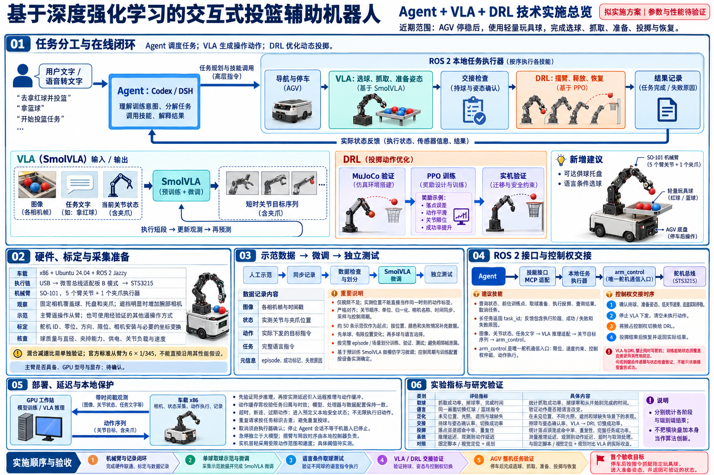
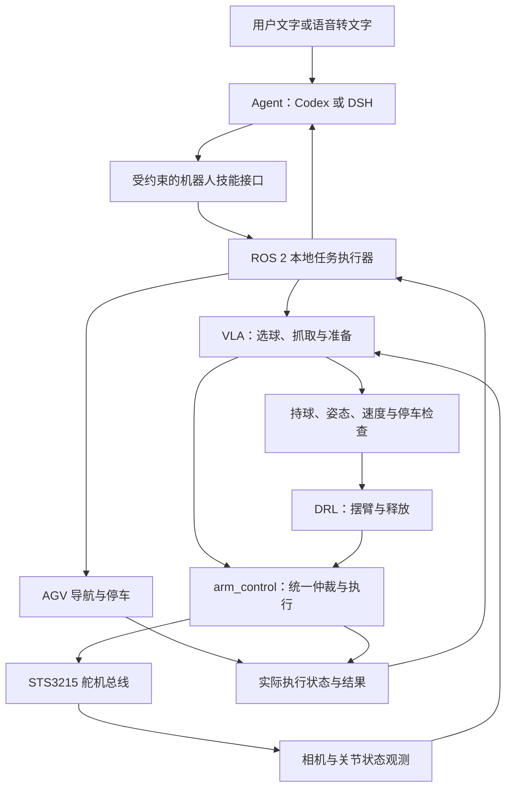

# 交互式投篮辅助机器人技术方案

更新日期：2026-10-29

研究课题：**基于深度强化学习的交互式投篮辅助机器人**

状态：**拟实施方案；接口、模型与性能尚未完成整机验证。**

本文整理当前讨论确定的方向及建议实施方案，并以仓库代码区分已有能力与待开发内容。数值阈值、控制频率、训练规模和硬件性能均须通过实测确定；未完成的实验不得写成结果。

## 1. 研究目标与范围

在已有 AGV 上安装 SO-101 / SOARM101 机械臂，构建能够理解用户训练意图、移动到训练位置、操作轻量玩具球并完成投掷的机器人。原毕业设计提供底盘和传感器代码基础，其巡检或搬运任务不等于本课题的研究目标。

近期固定范围：

- AGV 停稳后操作机械臂；先完成持球、摆臂、释放与恢复。
- 使用实际购买的轻量玩具球，实测质量、直径、摩擦与变形特征；不沿用旧材料的 600 g 标准篮球参数。
- 首先验证可重复定向投掷，再研究目标落点或篮筐命中。
- 建议新增可达供球托盘，逐步实现按指令选球、抓取并进入准备姿态。
- 用户交互、取球和动态投掷分阶段实现；当前不要求移动中投球、全场捡球或直接从人手中接球。

较长期应用可包括训练喂球、传球与投篮辅助，但相关任务需另行验证，不作为近期已经具备的能力。若一直人工装球且只有固定动作，VLA 的额外收益可能较小，应通过对照实验判断是否值得引入。

## 2. 当前仓库的实际基础

本次核对基线为 `33e39c9`。以下“已有”仅指存在代码或配置，不等于通过当前实机验收。

| 组件 | 已有内容 | 需要核实的限制 |
| --- | --- | --- |
| `agv_control` | Modbus TCP 桥接、心跳过滤、离散运动命令、键盘遥控、模式切换与命令超时逻辑 | 通信正常不等于底盘实际执行或停稳；需实测响应与制动 |
| `imu_ros2_device` | IMU 驱动及厂商库 | 数据质量、坐标、时间戳与融合链路需验证 |
| `ldlidar_ros2` | 雷达厂商驱动 | 型号、串口与安装参数按实物确认 |
| `sensor_bringup` | 传感器、建图、导航 launch 与参数 | Nav2 与定位需结合真实地图、TF 和底盘特性联调 |
| `command_odom` | 基于离散命令和固定速度的积分估计 | 属于命令推算，不能当作实际速度或可靠停车证明 |
| 机械臂、Agent、VLA、DRL | 本仓库尚无对应实现 | 本文描述的是开发计划 |

具体证据与部署注意点：

- [AGV 桥接](../sensor_ws/src/agv_control/agv_control/agv_bridge.py)存在 `/agv/control_mode`、`/agv/current_mode` 与命令超时处理。应保留原设备的 `0xBB` 心跳帧过滤逻辑。
- [命令里程计](../sensor_ws/src/sensor_bringup/sensor_bringup/command_odom.py)默认前进 0.20 m/s、后退 0.16 m/s、转速 0.75 rad/s，属于待重新标定的配置值。
- [导航启动](../sensor_ws/src/sensor_bringup/launch/nav_bringup.launch.py)采用 slam_toolbox 定位，`serialized_map` 默认空值；仅存在栅格地图并不说明序列化位姿图已准备好。
- 当前检查到的启动链路未启动 EKF 节点，不能把安装 `robot_localization` 依赖描述为已经完成传感器融合。
- 当前方案目标环境为 Ubuntu 24.04 / ROS 2 Jazzy；历史提交存在 Humble 描述，需要核对车载环境。
- 原交接材料是底盘背景资料，当前行为以代码与现场测量为准。第三方雷达驱动和 `vendor_ybimu` 不作为本方案的常规修改范围。

## 3. 分层架构与职责



图像由 imagegen 生成，用于辅助阅读；接口、约束与验收以本文文字为准。图中示例奖励项不代表已完成奖励设计，所有模块均应按其实际开发状态解读。



图中 VLA 与 DRL 到 `arm_control` 的连接表示分阶段独占接管，不表示同时输出。

| 层级 | 输入与输出 | 边界 |
| --- | --- | --- |
| Agent | 用户意图、系统状态 → 技能调用、任务说明 | 不生成实时舵机流，不编造目标坐标或完成状态 |
| 任务执行器 | 技能请求、实际状态 → 阶段切换、结果 | 检查前置条件、任务归属、去重、取消与超时 |
| VLA | 图像、任务文字、关节状态 → 短时动作序列 | 首版负责取球与准备，不承担高速释放时序 |
| DRL | 目标与机器人状态 → 投掷参数或受约束动作 | 先完成仿真与实机验证，再扩展策略自由度 |
| arm_control | 被授权的关节目标 → 舵机通信与遥测 | 唯一舵机访问入口，负责限位、速度约束与仲裁 |
| AGV 控制 | 导航或遥控命令 → 底盘动作 | 与机械臂控制分开；投掷阶段保持停车 |

VLA 描述模型的视觉、语言、动作输入输出关系；强化学习描述训练方法，两者并不互斥。本方案采用“VLA 示范微调 + DRL 投掷训练”的初期分工。大模型识别物体后调用固定脚本，不应被描述为已经实现 VLA 动作策略。

## 4. 硬件与标定

### 4.1 拟用硬件

| 设备 | 用途 | 待确认内容 |
| --- | --- | --- |
| 原 AGV + x86 | ROS 2、底盘、传感器、机械臂执行 | 系统版本、接口、实际停车与定位能力 |
| SO-101 + 6 个 STS3215 | 5 个臂关节与 1 个夹爪执行器 | 实际舵机型号、减速比、负载和速度 |
| 微雪 Bus Servo Adapter | USB 到舵机总线通信 | 实际板型、跳帽、驱动、串口与供电 |
| 固定相机 | 同时观察球、托盘和夹爪 | 帧率、延迟、遮挡、安装稳定性 |
| 可选腕部相机 | 改善近距离观察 | 按遮挡测试结果决定是否增加 |
| 供球托盘与玩具球 | 提供有限、可重复的取球场景 | 可达范围、球固定方式、质量、直径 |
| 主臂或其他遥操作装置 | 采集示范 | 是否具备、动作映射与校准 |
| GPU 工作站 | 微调与可选远程推理 | 显卡型号、显存、实测速度 |
| 可选 ESP32 与辅助传感器 | 球检测、光电门、电流或急停状态采集 | 不作为必须的机械臂主控制中转 |

拟采用执行链：`车载 x86 → USB → 微雪适配板（B 模式）→ STS3215 总线`。A 模式用于 MCU 的 UART 接口；它不表示适配板控制 MCU。ROS 2 负责系统协同，LeRobot / Feetech Motors Bus 作为拟采用的底层访问方案。

此前讨论的混合减速比配置需要按实物复核。LeRobot 官方 SO-101 文档中的标准从臂使用六个 1/345 舵机，1/191、1/345、1/147 的混合表对应主臂。若将混合配置用于执行臂，必须实测扭矩、速度、发热和可用动作范围，不能直接套用标准从臂性能。

### 4.2 上电与动作前的标定

- 舵机 ID、波特率、方向、零位、软限位和夹爪开合范围。
- 供电电压、配电、峰值电流与电源容量按实际型号确认，不推定为统一电压或混合电压。
- 相机名称、视角、时间戳、与动作数据的同步关系；需要空间定位时标定相机与机器人坐标关系。
- 机械臂安装位置、托盘可达范围、自碰撞、与车体或地面的干涉。
- 实测玩具球的质量、直径、夹持稳定性；不能把夹爪闭合直接当作持球成功。
- 实测关节控制周期、响应延迟、最大可用速度、负载下跟踪误差与释放延迟。
- 明确底盘实际停稳的测量来源；命令里程计或一条停止命令均不足以证明停车。

## 5. VLA 的最小可行任务

初期技能：`观察 → 靠近 → 夹住 → 提起 → 移动到准备姿态 → 保持`。

先固定 AGV 和相机，用单球及有限位置变化验证动作学习；随后增加多球、颜色和语言条件。首轮不同时扩大位置、背景、物体、光照和操作方式，否则难以归因失败。

### 5.1 模型输入输出

拟优先试验 LeRobot 的 SmolVLA 基础模型，并使用本机示范数据微调。

| 项目 | 内容 |
| --- | --- |
| 图像 | 一个或多个相机的图像，名称和顺序与训练配置一致 |
| 语言 | 例如“拿起红色球，移动到准备姿态”，与示范任务定义对应 |
| 状态 | 当前关节位置与夹爪状态；实际采用的字段须与模型处理器一致 |
| 输出 | 一段关节目标位置序列，包含夹爪动作；具体单位与表示随数据配置固定 |
| 闭环 | 执行短段动作，获取新观测，再生成后续动作 |

预训练模型不保证在本机、相机和球上直接成功。初期采用模仿学习微调；中文指令与同义表达的效果需测试，必要时由 Agent 映射为训练时使用的规范任务描述。

### 5.2 示范采集与数据结构

优先考虑主臂遥操作从臂；没有主臂时，可采用经过验证的其他遥操作方式。无论采用何种方式，都需记录实际下发的动作和实际观测。

| 记录内容 | 必要信息 |
| --- | --- |
| 图像 | 各相机帧、采集时间戳 |
| 状态 | 实测关节位置、夹爪位置与时间戳 |
| 动作 | 实际下发的目标值、顺序、单位和时间戳 |
| 任务 | 完整任务文字及对应示范 |
| episode 元信息 | 初始条件、球位置、成功标记、失败原因、配置版本 |

仅有操作视频不足以构建该控制数据集。实测当前位置不能直接当成同一时刻的动作标签。采样周期、关节顺序、单位、归一化、相机名称与处理器在采集、训练、回放和部署时必须一致；需要检查丢帧、延迟和时钟偏差。

约 50 条示范仅作为官方建议的探索起点，不是成功率保证。应覆盖各类变化并重复采集，优先补充失败位置或抓取方式的有效示范。失败数据单独标注，不能未经筛选全部当作成功动作模仿。

### 5.3 微调与测试

1. 先验证数据回放与动作对应关系，再启动 GPU 微调。
2. 按完整 episode、采集批次或场景划分训练、验证、测试，避免相邻帧泄漏。
3. 用验证集选择模型，最终测试集不用于反复调参。
4. 保存模型、数据版本、随机种子、处理器、关节标定与相机配置。
5. 测试未见位置、适度光照变化、遮挡、球缺失与抓取失败。
6. 在同一画面中分别给出“拿红球”和“拿蓝球”指令，验证动作是否随语言改变；不改变说明尚未验证语言条件控制。

训练步数、batch size、显存需求、控制频率和达到的成功率通过实测确定，本文不承诺固定时长或硬件吞吐。

## 6. 机械臂基础控制、MuJoCo 与 DRL

### 6.1 先建立可用控制基线

实施顺序为：手动关节控制 → 预设轨迹 → 参数化轨迹 → MuJoCo scripted throw → PPO → 实机迁移。

`arm_control` 第一版需支持位置控制、关节状态、必要遥测、限位、通信超时、急停联动及 mock backend。实物没有的电流、力或持球信息不能伪造为传感器反馈。预设动作先覆盖人工装球后的持球、摆臂、释放和恢复，避免 VLA 成为底层控制开发的前置阻塞。

### 6.2 MuJoCo 验证顺序

1. 建立关节轴、零位、限位、连杆尺寸、质量、惯量、执行器限制与碰撞模型。
2. 单关节与夹爪测试，核对正方向、重力、碰撞和实物姿态。
3. 添加实测玩具球、地面或篮筐、接触摩擦与释放机制。
4. 先用脚本验证稳定持球、脱离夹爪与正常飞行，再优化目标误差。
5. 测量并建模执行器延迟、速度限制、负载相关跟踪误差和夹爪释放延迟。
6. 对球参数、摩擦、初始位姿、观测噪声和执行器参数施加有依据的扰动，评估鲁棒性。

最初可只仿真固定底座机械臂，随后加入车体碰撞与安装条件。确定性环境重复运行结果相同不构成鲁棒性证明，需要改变随机种子和扰动条件。

### 6.3 PPO 的初期建模选择

建议首先评估低维参数化投掷策略：给定目标相对位置与准备状态，由策略选择受限轨迹参数、时间尺度和释放时刻，再由本地控制器执行。该选择更便于建立可检查基线；若效果不足，再评估逐步输出关节增量或目标值。动作表示属于待实验确定的设计，不是已实现接口。

候选观测包括关节位置、估计或测得速度、任务阶段、目标相对位置及可获得的持球信息；训练中使用的特征必须在实机可获得，或明确其替代估计方法。

奖励可包括任务成功、目标误差、动作平滑和控制代价。碰撞、关节限位和超时应由约束与终止逻辑处理，不能仅依赖奖励惩罚。首版位置控制器不应被描述为已具备直接力矩控制能力。

落点任务的一个明确指标为：

```text
落点误差 = sqrt((x_land - x_target)^2 + (y_land - y_target)^2)
```

其中落点取球第一次接触地面的坐标。若目标是进篮，应另行定义穿越篮筐平面且方向正确的成功判据，不能把地面落点误差等同于命中率。

每轮记录初始条件、目标、轨迹参数、释放时刻、球轨迹、结果、约束触发、策略版本与随机种子。训练时的准备姿态、夹持状态与负载范围必须覆盖实际 VLA 交接状态。

## 7. Agent 接入与技能接口

Codex 和 DeepSeek Harness 均作为上层任务 Agent 候选。优先复用现有 Codex 环境验证技能调用，再按同一接口比较 DSH；不需要首版同时部署两个 Agent。

- Codex 可通过 SDK / App Server 接入应用，通过 MCP 调用机器人技能。这里是连接机器人 MCP 服务，不是采用已经移除的 `codex mcp-server` 命令。
- DSH 可通过工具插件封装技能，但需核实本地 DSH / Helm 的具体项目与版本，不能假定历史会话接口等于官方当前接口。
- 框架运行在车载或工作站，不代表大模型在本地推理；模型提供方、网络和账户依赖需单独确认。
- 机器人运行时仅开放所需技能；代码编辑与工程维护使用开发工作流，运行中的 Agent 不通过临时改代码来驱动舵机。

以下是建议接口语义，**不是仓库中已经存在的 API**：

| 技能 | 请求信息 | 返回与完成依据 |
| --- | --- | --- |
| `get_robot_state` | 查询范围 | 阶段、可用性、故障、带时间戳状态 |
| `navigate_to_station` | 已登记的训练点 ID | task_id、导航结果及停车确认状态 |
| `pick_and_prepare` | 规范任务文字、球的条件 | task_id、抓取与准备状态、失败原因 |
| `execute_throw` | 已标定目标 ID、策略配置 ID | task_id、投掷结果与记录引用 |
| `get_task_status` | task_id | 阶段、进度、最终结果或错误 |
| `cancel_task` | task_id | 取消受理状态；后续由执行器确认实际终止 |

长时操作拟映射为 ROS 2 Action；状态查询采用 Service 或状态 Topic。具体消息定义在开发时确定。目标位置必须来自已登记配置或经过坐标变换的感知结果，不能由语言模型随意生成坐标。

每个动作请求需有任务身份与重复请求判定机制。接口收到请求后先返回受理或拒绝，执行完成后才报告成功。网络重试不能导致重复投球；多次投球必须逐次确认供球和准备条件。

## 8. 本地状态机与控制权交接

建议状态流：

```text
IDLE → NAVIGATING → VERIFY_STOP → PICKING → PREPARED
     → VERIFY_HANDOFF → THROWING → RECOVERING → COMPLETED
任一相关阶段 → FAILED / CANCELING / 本地安全状态
```

状态命名是设计草案。人工装球基线可以跳过 `PICKING`，但必须完成持球与准备检查。

VLA 到 DRL 的交接步骤：

1. 检查持球、准备姿态、低关节速度与底盘实际停稳；阈值及判定持续时间按实测配置。
2. 停止 VLA 继续提交动作，清空尚未执行的动作缓存，丢弃旧任务或旧控制阶段的迟到结果。
3. 将机械臂独占控制权切换到投掷控制器，记录交接状态。
4. DRL 在已验证范围内决定投掷参数或动作，由本地控制器执行摆臂与释放。
5. 进入恢复阶段，返回传感器或测量支持的结果，再允许下一任务。

VLA 与 DRL 不得同时写同一舵机总线。`arm_control` 是唯一通信入口；单独调试 LeRobot 硬件脚本时，也必须停止另一个总线所有者。控制权规则必须由程序执行，不能仅写在 Agent 提示词中。

完成判断采用关节状态、持球检测、视觉或其他经验证的观测。仅模型宣告“完成”、夹爪关闭或停止命令已发送，都不能作为真实完成的充分证据。

## 9. 部署、时间同步与故障处理

### 9.1 部署分工

| 位置 | 拟运行内容 |
| --- | --- |
| 车载 x86 | ROS 2、传感器、底盘与机械臂执行器、任务状态机、日志和本地保护 |
| GPU 工作站 | VLA 微调与可选远程推理、MuJoCo / PPO 训练与评估 |
| Agent 进程 | 可在工作站或车载运行，通过技能接口连接；实际推理服务按选择部署 |

先获得成功的同步 VLA 推理基线，再按实测延迟决定是否采用远程推理与动作缓存。LeRobot 的远程推理可把观测发送到工作站并返回动作片段，但不能未经改造与 `arm_control` 同时访问舵机。部署需固定 LeRobot、模型、处理器和接口版本，避免混用不同版本示例命令。

### 9.2 运行约束

- 观测与动作携带时间戳、任务身份及有效控制阶段；处理跨机时钟偏差，检测过期观测与迟到动作。
- 调整缓存长度时同时评估连续性和反馈时效，不能以无限缓存掩盖延迟。
- 超时、断连、球丢失、关节异常或任务取消时，进入预定义且经过验证的本地安全状态，不无限继续旧动作。
- “保持位置”“受控停止”或“卸力”需按机械臂、姿态与持球状态决定，不能默认断电对所有情况都安全。
- 急停链路独立于大模型与网络；软件状态必须反映实际急停条件。
- 停止 Agent 会话不等于机器人停止；取消必须传递到执行器并由其反馈终止状态。
- 已释放的球无法通过软件取消收回；取消结果须如实记录当前物理阶段。
- 首次实机验证限制动作范围与速度，检查自碰撞、车体干涉和目标区域。
- 摆臂与释放时序由本地控制器负责，不等待大模型逐步回复。

## 10. 实施阶段与验收

| 阶段 | 交付内容 | 验证方法与通过依据 |
| --- | --- | --- |
| P0 基础复核 | 硬件清单、标定、AGV 与传感器状态 | 能说明各观测来源，验证实际停车，明确缺失条件 |
| P1 机械臂基础 | arm_control、mock、遥测与预设动作 | 无硬件验证接口；实机完成受限动作、超时和急停检查 |
| P2 预设投掷 | 人工装球后的可重复投掷与日志 | 持球、释放、恢复可重复，结果可测量 |
| P3 Agent 原型 | 同一技能接口连接模拟执行器 | 指令、状态、失败、重复请求与取消均有明确结果 |
| P4 VLA 取球 | 示范数据、微调模型与独立测试 | 指令选球、抓取、准备状态可验证；报告失败分布 |
| P5 MuJoCo / DRL | 校准模型、脚本基线、PPO 与迁移实验 | 与基线比较，报告目标误差、成功率和约束触发 |
| P6 整机集成 | AGV、Agent、VLA、DRL 与记录闭环 | 完整任务成功、交接互斥、故障与取消行为通过验证 |

仿真和 Agent mock 可在机械臂开发期间独立推进。首个 VLA 验收目标为：**AGV 停稳后，机器人按指令抓起指定玩具球，进入准备姿态，并返回可验证状态。** 此后再接 DRL 完成投掷，不把一次接通所有模块作为首次里程碑。

## 11. 实验与论文评价

| 评价对象 | 指标与实验设计 |
| --- | --- |
| 取球 | 抓取成功率、掉球率、完成时间；按球位置和场景分组 |
| 语言 | 同画面切换指令的选择正确率；同义表达另行测试 |
| 泛化 | 未见位置、光照、遮挡、球缺失等测试条件 |
| 交接 | 持球及姿态确认率、切换成功率、异常拒绝情况 |
| 投掷 | 落点误差或明确命中率、重复性、约束触发和恢复成功率 |
| Agent | 意图理解、合法技能调用率、任务成功率、错误恢复与费用 |
| 系统 | 推理延迟、观测到动作延迟、任务时长、断连与取消响应 |
| 端到端 | 从用户请求到结果记录的完整成功率，不只报告单模块最好成绩 |

对照建议：固定状态机 vs Agent；视觉定位 + 规划 / 固定脚本 vs VLA；预设或参数搜索投掷 vs PPO。保持场景、目标、球和评价预算可比，记录试验次数、随机种子、均值、离散程度及失败原因。报告置信区间时说明计算方法。

Agent、VLA 和 DRL 的组合本身不构成已证实的算法创新。可进一步研究负载条件下的执行器建模、实测约束的域随机化和控制能力约束下的课程学习，但这些仍是待文献核查与消融验证的研究假设。

## 12. 待确认项

- 执行臂实际舵机型号、减速比、供电及其负载性能。
- 是否已有主臂或其他可用遥操作装置。
- 相机数量、型号、安装、帧率与遮挡情况。
- GPU 型号、显存、训练与部署位置、网络延迟。
- 玩具球质量与直径、托盘结构、目标篮筐或落点区域。
- 实际停车、持球和投掷结果的可靠检测来源。
- ROS 2 部署版本、地图与 TF、定位误差和车体安装关系。
- 控制频率、超时、速度与姿态阈值，以及每阶段验收目标值。
- Codex 或 DSH 的具体版本、账户及可用连接方式。

这些信息影响配置与实现，但不阻碍先开发 mock 接口、日志格式和受限的机械臂基础控制。

## 13. 官方参考资料

以下资料用于核对模型与接入能力，工程实现时仍需固定所用版本；硬件配置和性能以本机实测为准。

1. [LeRobot SmolVLA：输入输出、示范与微调](https://huggingface.co/docs/lerobot/smolvla)
2. [LeRobot SO-101：装配、舵机与校准](https://huggingface.co/docs/lerobot/so101)
3. [LeRobot Remote Inference：远程推理与动作缓冲](https://huggingface.co/docs/lerobot/main/en/remote_inference)
4. [Codex SDK：程序化接入](https://learn.chatgpt.com/docs/codex-sdk)
5. [Codex MCP：外部工具接入](https://learn.chatgpt.com/docs/extend/mcp?surface=cli)
6. [DeepSeek Harness 官方仓库：插件化 Agent 运行框架](https://github.com/deepseek-ai/deepseek-harness)
7. [DeepSeek Harness 工具接口](https://github.com/deepseek-ai/deepseek-harness/blob/master/docs/tool-catalog.md)
